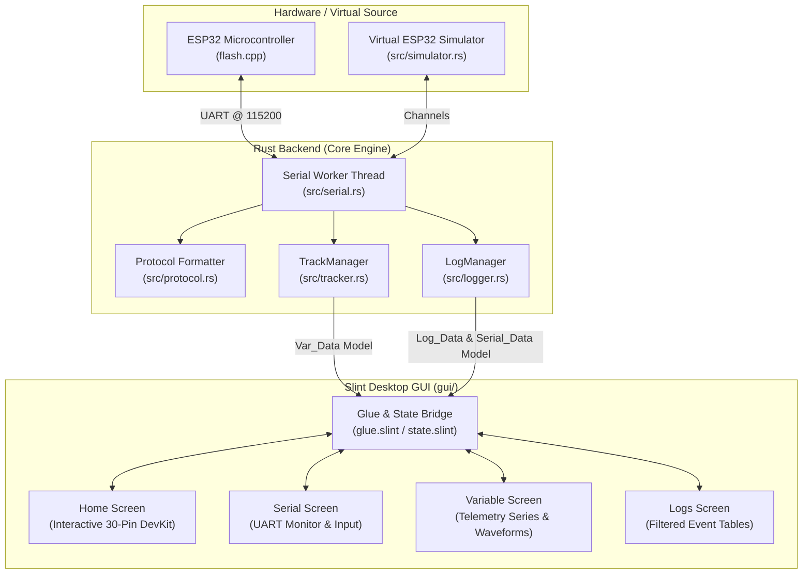

# ESP32-Studio

**A modern, reactive desktop GUI and telemetry workbench for ESP32 microcontrollers.**
## **Work in Progresss.**


Built with **Rust** and **Slint**, ESP32-Studio provides real-time GPIO control, streaming variable telemetry visualizations, a dedicated serial monitor, and an integrated virtual simulator for developing and debugging ESP32 projects without hardware dependencies.

---

## Features

- **Interactive 30-Pin ESP32 Pinout**:
  - Full graphical representation of the **ESP32 NodeMCU DevKit v1 (30-pin)** board.
  - Interactive click-to-toggle pin logic levels (`HIGH` / `LOW`) with real-time hardware status verification.
  - Clear pinout labels for all GPIO, power (`3V3`, `VIN`), Ground (`GND`), and Enable (`EN`) pins.

- **Variable Telemetry Analyzer**:
  - Live rolling waveform stick charts (60 historical samples).
  - Dynamic variable discovery: automatically detects and tracks incoming telemetry streams (e.g. Temperature, Voltage, Humidity, Free Heap, CPU Load).
  - Clean floating-point formatting, sample counts, and dynamic max-scale calculations.

- **Filtered Serial Terminal**:
  - Dedicated UART serial console with bidirectional communication.
  - Sends commands with automatic newline normalization (`<pin>:on`, `<pin>:off`, raw serial).
  - **Telemetry Filtering**: Raw JSON telemetry packets are filtered out of the serial monitor so you only see genuine application input/output (`TX`, `RX`, `SYS`, `ERR`).
  - Rolling 60-entry limit with zero-flicker UI updates.

- **Structured Event Logger**:
  - Categorized log table (`Date`, `Time`, `Kind`, `Message`) with visual badges for Telemetry and Serial flows.
  - Independent filter toggles for Telemetry, Inbound Serial, and Outbound Serial messages.
  - Rolling 180-entry history.
  - One-click timestamped log export (`ESP32-Studio_logs_YYYYMMDD_HHMMSS.txt`).

- **Built-In Virtual ESP32 Simulator**:
  - Built-in multi-threaded NodeMCU simulator that runs out of the box.
  - Simulates dynamic realistic environmental readings (sine-wave temperature, voltage jitter, heap fluctuation) and responds to pin commands.
  - Enables full UI development and offline testing without plugging in hardware.

- **Buttery-Smooth Reactive Architecture**:
  - Powered by Rust and Slint's native GUI compilation.
  - Uses persistent `Rc<VecModel>` instances with granular row-level mutations (`push` and `remove(0)`).
  - Zero full-table reconstructions or frame drops during rapid 2-second telemetry ticks.

---

## Architecture



---

## Repository Structure

```
ESP32-Studio/
├── Cargo.toml               # Rust package dependencies (slint, serialport, serde, chrono)
├── build.rs                 # Slint build script
├── flash.cpp                # Ready-to-flash Arduino/ESP-IDF firmware sketch
├── protocol.slint           # Shared telemetry and pin data definitions
├── gui/                     # Slint GUI declarations
│   ├── app.slint            # Main application window & layout
│   ├── glue.slint           # Rust-to-Slint data interface & callbacks
│   ├── state.slint          # Global UI reactive state
│   ├── theme.slint          # Dark color palette & design tokens
│   ├── app/
│   │   ├── navbar.slint     # Side navigation bar
│   │   ├── topbar.slint     # Connection & screen action toolbar
│   │   ├── statusbar.slint  # Footer connection status
│   │   ├── screen.slint     # Screen exports
│   │   └── screens/
│   │       ├── home/        # Interactive ESP32 NodeMCU pinout screen
│   │       ├── serial/      # Serial monitor & command input
│   │       ├── variable/    # Variable telemetry selector & waveform charts
│   │       └── logs/        # Filterable system and telemetry log table
│   └── icons/               # SVG UI iconography
└── src/                     # Rust backend source
    ├── main.rs              # App entry point, callback registration & event loop
    ├── protocol.rs          # Command serialization & validation
    ├── serial.rs            # Dedicated serial port I/O background worker
    ├── simulator.rs         # Integrated virtual 30-pin ESP32 simulator
    ├── tracker.rs           # Dynamic variable discovery & rolling history manager
    └── logger.rs            # Dual-buffer logger (Logs: 180 lines, Serial: 60 lines)
```

---

## Getting Started

### Prerequisites

- **Rust toolchain** (2024 edition or latest stable): [rustup.rs](https://rustup.rs/)
- **C++ Build Tools & CMake** (required by Slint / FemtoVG):
  - **Linux (Ubuntu/Debian)**:
    ```bash
    sudo apt update
    sudo apt install build-essential cmake libfontconfig1-dev libudev-dev
    ```
  - **macOS**:
    ```bash
    xcode-select --install
    brew install cmake
    ```
  - **Windows**: Install Visual Studio Build Tools with C++ desktop workload.

### Build and Run

1. **Clone the repository**:
   ```bash
   git clone https://github.com/your-username/ESP32-Studio.git
   cd ESP32-Studio
   ```

2. **Run the application**:
   ```bash
   cargo run
   ```

3. **Run unit tests**:
   ```bash
   cargo test
   ```

---

## Connecting to an ESP32

### Option 1: Virtual Simulator (Default)
When launched, ESP32-Studio automatically starts the internal **Virtual ESP32 Simulator**.
- In the top bar, the port dropdown will list `ESP32-Simulator (Virtual)`.
- Click **Connect** (already connected by default).
- You can immediately test pin toggles on the Home screen, inspect incoming variables in the Variable tab, and send test commands.

### Option 2: Physical Hardware
1. Connect your **ESP32 NodeMCU DevKit v1** via USB.
2. Flash the provided firmware sketch [`flash.cpp`](flash.cpp) onto your board using Arduino IDE or PlatformIO:
   - Baud Rate: `115200`
   - Board: `NodeMCU-32S` or `ESP32 Dev Module`
3. In ESP32-Studio's top bar, click the **Refresh** button next to the port dropdown.
4. Select your board's serial port (e.g. `/dev/ttyUSB0` on Linux, `COM3` on Windows).
5. Ensure baud rate is set to `115200` and click **Connect**.

---

## Communication Protocol

ESP32-Studio communicates over UART (or internal channels) using human-readable commands and compact JSON telemetry:

### 1. Pin Commands 
Format: `<pin_number>:<action>\n`
- `23:on\n` — Drives GPIO 23 HIGH.
- `2:off\n` — Drives GPIO 2 LOW.# ESP32-Studio

**A modern, reactive desktop GUI and telemetry workbench for ESP32 microcontrollers.**

Built with **Rust** and **Slint**, ESP32-Studio provides real-time GPIO control, streaming variable telemetry visualizations, a dedicated serial monitor, and an integrated virtual simulator for developing and debugging ESP32 projects without hardware dependencies.

---

## Features

- **Interactive 30-Pin ESP32 Pinout**:
  - Full graphical representation of the **ESP32 NodeMCU DevKit v1 (30-pin)** board.
  - Interactive click-to-toggle pin logic levels (`HIGH` / `LOW`) with real-time hardware status verification.
  - Clear pinout labels for all GPIO, power (`3V3`, `VIN`), Ground (`GND`), and Enable (`EN`) pins.

- **Variable Telemetry Analyzer**:
  - Live rolling waveform stick charts (60 historical samples).
  - Dynamic variable discovery: automatically detects and tracks incoming telemetry streams (e.g. Temperature, Voltage, Humidity, Free Heap, CPU Load).
  - Clean floating-point formatting, sample counts, and dynamic max-scale calculations.

- **Filtered Serial Terminal**:
  - Dedicated UART serial console with bidirectional communication.
  - Sends commands with automatic newline normalization (`<pin>:on`, `<pin>:off`, raw serial).
  - **Telemetry Filtering**: Raw JSON telemetry packets are filtered out of the serial monitor so you only see genuine application input/output (`TX`, `RX`, `SYS`, `ERR`).
  - Rolling 60-entry limit with zero-flicker UI updates.

- **Structured Event Logger**:
  - Categorized log table (`Date`, `Time`, `Kind`, `Message`) with visual badges for Telemetry and Serial flows.
  - Independent filter toggles for Telemetry, Inbound Serial, and Outbound Serial messages.
  - Rolling 180-entry history.
  - One-click timestamped log export (`ESP32-Studio_logs_YYYYMMDD_HHMMSS.txt`).

- **Built-In Virtual ESP32 Simulator**:
  - Built-in multi-threaded NodeMCU simulator that runs out of the box.
  - Simulates dynamic realistic environmental readings (sine-wave temperature, voltage jitter, heap fluctuation) and responds to pin commands.
  - Enables full UI development and offline testing without plugging in hardware.

- **Buttery-Smooth Reactive Architecture**:
  - Powered by Rust and Slint's native GUI compilation.
  - Uses persistent `Rc<VecModel>` instances with granular row-level mutations (`push` and `remove(0)`).
  - Zero full-table reconstructions or frame drops during rapid 2-second telemetry ticks.

---

## Repository Structure

```
ESP32-Studio/
├── Cargo.toml               # Rust package dependencies (slint, serialport, serde, chrono)
├── build.rs                 # Slint build script
├── flash.cpp                # Ready-to-flash Arduino/ESP-IDF firmware sketch
├── protocol.slint           # Shared telemetry and pin data definitions
├── gui/                     # Slint GUI declarations
│   ├── app.slint            # Main application window & layout
│   ├── glue.slint           # Rust-to-Slint data interface & callbacks
│   ├── state.slint          # Global UI reactive state
│   ├── theme.slint          # Dark color palette & design tokens
│   ├── app/
│   │   ├── navbar.slint     # Side navigation bar
│   │   ├── topbar.slint     # Connection & screen action toolbar
│   │   ├── statusbar.slint  # Footer connection status
│   │   ├── screen.slint     # Screen exports
│   │   └── screens/
│   │       ├── home/        # Interactive ESP32 NodeMCU pinout screen
│   │       ├── serial/      # Serial monitor & command input
│   │       ├── variable/    # Variable telemetry selector & waveform charts
│   │       └── logs/        # Filterable system and telemetry log table
│   └── icons/               # SVG UI iconography
└── src/                     # Rust backend source
    ├── main.rs              # App entry point, callback registration & event loop
    ├── protocol.rs          # Command serialization & validation
    ├── serial.rs            # Dedicated serial port I/O background worker
    ├── simulator.rs         # Integrated virtual 30-pin ESP32 simulator
    ├── tracker.rs           # Dynamic variable discovery & rolling history manager
    └── logger.rs            # Dual-buffer logger (Logs: 180 lines, Serial: 60 lines)
```

---

## Getting Started

### Prerequisites

- **Rust toolchain** (2024 edition or latest stable): [rustup.rs](https://rustup.rs/)
- **C++ Build Tools & CMake** (required by Slint / FemtoVG):
  - **Linux (Ubuntu/Debian)**:
    ```bash
    sudo apt update
    sudo apt install build-essential cmake libfontconfig1-dev libudev-dev
    ```
  - **macOS**:
    ```bash
    xcode-select --install
    brew install cmake
    ```
  - **Windows**: Install Visual Studio Build Tools with C++ desktop workload.

### Build and Run

1. **Clone the repository**:
   ```bash
   git clone https://github.com/your-username/ESP32-Studio.git
   cd ESP32-Studio
   ```

2. **Run the application**:
   ```bash
   cargo run
   ```

3. **Run unit tests**:
   ```bash
   cargo test
   ```

---

## Connecting to an ESP32

### Option 1: Virtual Simulator (Default)
When launched, ESP32-Studio automatically starts the internal **Virtual ESP32 Simulator**.
- In the top bar, the port dropdown will list `ESP32-Simulator (Virtual)`.
- Click **Connect** (already connected by default).
- You can immediately test pin toggles on the Home screen, inspect incoming variables in the Variable tab, and send test commands.

### Option 2: Physical Hardware
1. Connect your **ESP32 NodeMCU DevKit v1** via USB.
2. Flash the provided firmware sketch [`flash.cpp`](flash.cpp) onto your board using Arduino IDE or PlatformIO:
   - Baud Rate: `115200`
   - Board: `NodeMCU-32S` or `ESP32 Dev Module`
3. In ESP32-Studio's top bar, click the **Refresh** button next to the port dropdown.
4. Select your board's serial port (e.g. `/dev/ttyUSB0` on Linux, `COM3` on Windows).
5. Ensure baud rate is set to `115200` and click **Connect**.

---

